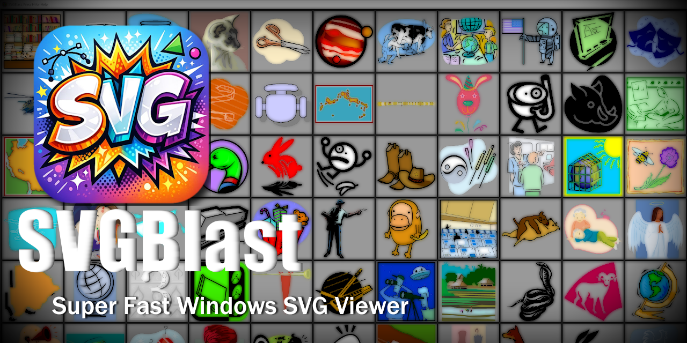
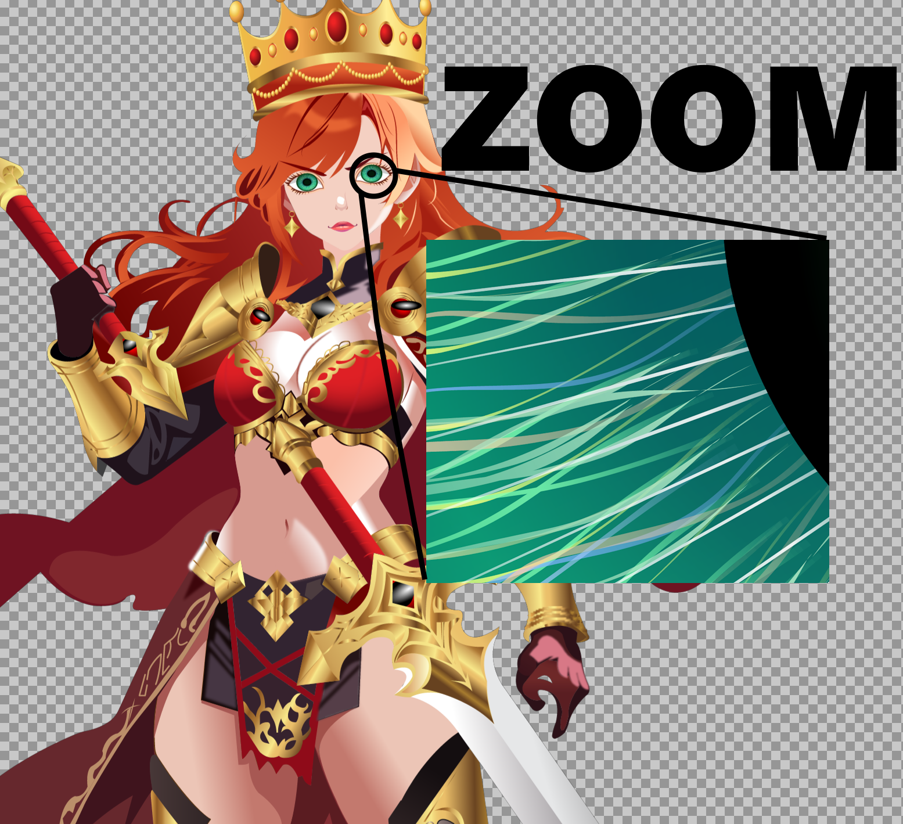

# SVGBlast

A fast, lightweight SVG viewer for Windows with GPU-accelerated rendering.

---

## Download

Get the [latest release](https://github.com/Zayno/SVGBlast/releases/latest). Two options:

- **Installer** (`SVGBlast-x.y-Setup.exe`): installs SVGBlast for you (no admin needed) or for all users, adds it to the Start menu and registers it for `.svg` files. On the last page it can open Windows' Default apps settings so you can make SVGBlast your SVG viewer.
- **Portable** (`SVGBlast-x.y-Portable.exe`): a single exe, nothing to install. Run it, or drag an SVG onto it.

## Features

**Viewer**
- EXTREMELY fast thumbnailer
- Smooth zoom with mouse wheel (zoom-to-cursor)
- Pan with click-and-drag
- Checkerboard transparency background
- High-quality re-rendering at any zoom level

**Folder Browser**
- Thumbnail grid of all SVGs in a folder
- Multi-threaded background thumbnail generation
- Double-click to explore, double-click to return

**Export**
- Save to PNG at current zoom level
- Copy filename to clipboard

**Performance**
- Direct3D 11 GPU-accelerated rendering
- Background rendering keeps UI responsive
- Efficient texture management (up to 16K textures)
- Virtualized thumbnail grid for thousands of files

---

## Controls

| Action | Input |
|--------|-------|
| Zoom | Mouse wheel |
| Pan | Left-click drag |
| Browse folder | Double-click |
| Context menu | Right-click |
| Help | `H` |

---

## Zoom Demo
Download [Princess Kitaro SVG](https://github.com/Zayno/SVGBlast/releases/download/V1.1/Princess.Kitaro.svg) and view it with SVGBlast!

## Youtube Demo

---

## Requirements

- Windows 10/11
- DirectX 11 compatible GPU

---

## Libraries

- [resvg](https://github.com/RazrFalcon/resvg) — SVG rendering
- [Dear ImGui](https://github.com/ocornut/imgui) — UI
- [stb_image_write](https://github.com/nothings/stb) — PNG export
